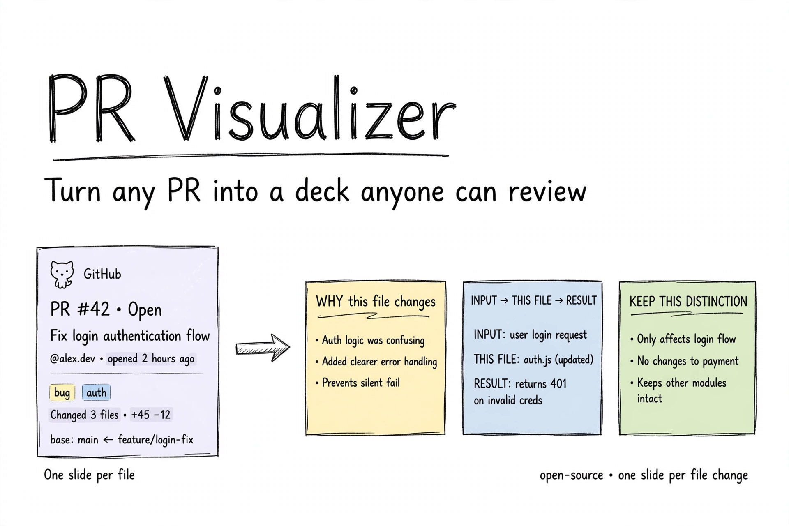
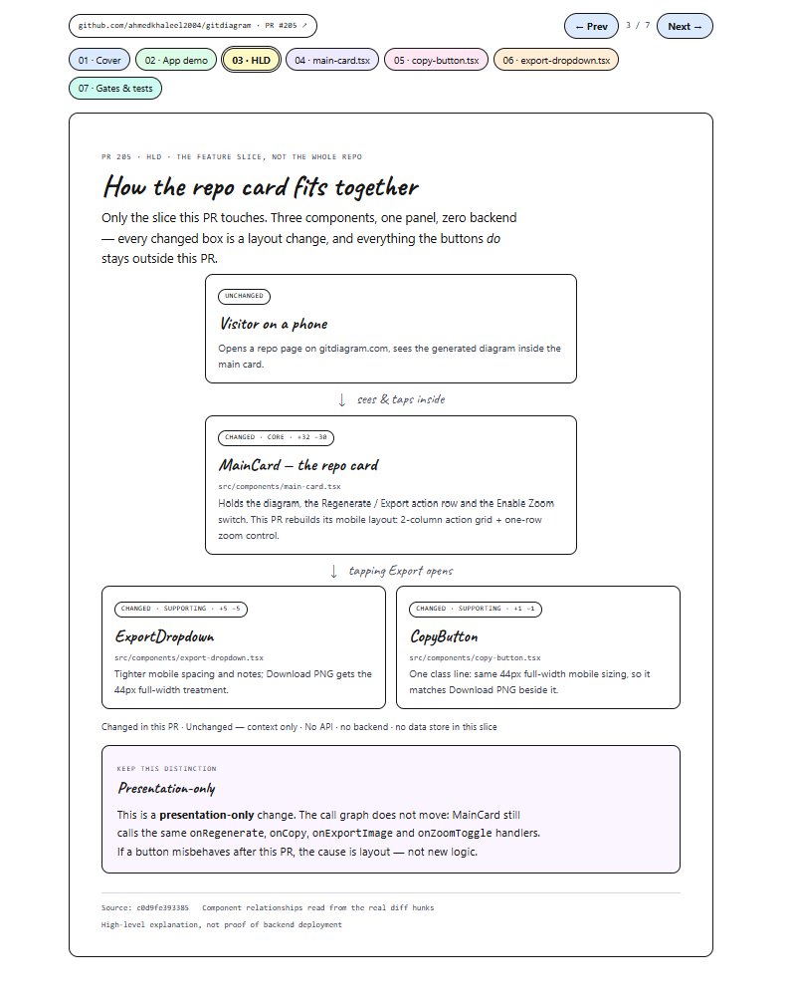

# PR Visualizer — Skill

An agent skill that turns a GitHub PR link into a plain-language, learning-focused slide deck that makes the PR easy to review.

**Input:** a PR URL. **Output:** a slide deck — PowerPoint first, HTML as the interactive twin — one slide per file change, plus an app-level slide showing what feature is changing, with a demo of the app itself.



## What a deck looks like

- **Cover** — the PR in one line, with the real numbers (files, +/−, triage counts)
- **App-level feature slide** — what feature is changing, with a demo of the app itself (real screenshot, or a labelled mock — never a mock passed off as a screenshot), Before/After toggle
- **HLD slide** — the feature's architecture, before → after
- **One slide per file** — header (`PR <number> / <n> of <total>`, filename, full path), numbered group, pale yellow **WHY this file changes** box, **INPUT → THIS FILE → RESULT** flow, pale lavender **KEEP THIS DISTINCTION** box, and a source footer with the commit hash
- **Gates & tests slide** — safety gates (secrets, auth, validation, migrations, breaking changes, dependencies) and test coverage, with honest provenance

Style: **Classic Sketchbook, Clean v2** — pure white background, pale pastel boxes and coloured buttons/cards, handwritten titles (Caveat) with clean Inter body text, thin ink borders, no shadows. All text black, no white text anywhere. No dark mode, no saturated colours.

## Example output

The HLD slide from the sample deck (gitdiagram PR #205) — the feature slice only, changed boxes highlighted, and the distinction that matters:



The per-file slide — the signature format, with its WHY box, INPUT → THIS FILE → RESULT flow, and KEEP THIS DISTINCTION box — is reproduced in full in `SKILL.md` under "Worked example".

## Install

Copy this folder into your skills directory, e.g.:

```sh
# Claude Code
cp -r pr-visualizer-skill ~/.claude/skills/pr-visualizer

# Muse (custom skills)
cp -r pr-visualizer-skill ~/workspace/custom-skills/pr-visualizer
```

Or add it with a skills manager:

```sh
npx skills add HarshitSharma007/pr-visualizer-skill
```

## Use

Ask your agent to explain a PR, for example:

> Explain https://github.com/ahmedkhaleel2004/gitdiagram/pull/205 as a PR Visualizer deck

The skill fetches the real diff from the GitHub API (no token needed for public repos; it prefers the companion `prviz` CLI when available), triages every file into core / supporting / mechanical, finds the changed functions and their callers from the parsed code, checks the safety gates, and builds the deck — grounding every claim in a `file:line` reference. Every step in `SKILL.md` names its tool and its fallback, so the agent does not have to invent the implementation.

## Example

A sample deck built with this skill: **gitdiagram PR #205, "Tighten the mobile repo card layout"** — 7 slides, cover + interactive phone app-demo + HLD + one slide per file (`main-card.tsx`, `copy-button.tsx`, `export-dropdown.tsx`) + gates & tests. All numbers grounded in the real diff and PR body (closed card 376px → 278px at 390px; 282 tests reported in the PR validation, not re-run). The `main-card.tsx` slide is reproduced in full, filled in, in `SKILL.md` under "Worked example".

View the full sample deck: [`examples/gitdiagram-pr-205/index.html`](examples/gitdiagram-pr-205/index.html) — a single self-contained file; download it and open it in a browser to click through all 7 slides.

## Rules the skill enforces

- **Ground everything in the real diff.** No invented functions, callers, numbers, or test results.
- **Plain language, key points only.** ~120 words max per file card.
- **Parsed edges are facts; guessed edges are suggestions.** Unresolvable calls go in a "Could not trace (dynamic)" bucket, never silently dropped.
- **Test presence is never presented as coverage %.**
- **The deck explains; it does not approve or block.**

## Companion project

The CLI that powers the fetching and triage steps (M1: PR → file list with triage) is TypeScript, MIT, and not published on GitHub yet — it will live at `github.com/HarshitSharma007/pr-visualizer` when it is. Until then, the skill's Step 1 gives the exact GitHub API calls to use instead. This skill is the format and workflow; the CLI is the deterministic engine underneath it.

## License

MIT — see [LICENSE](LICENSE).
